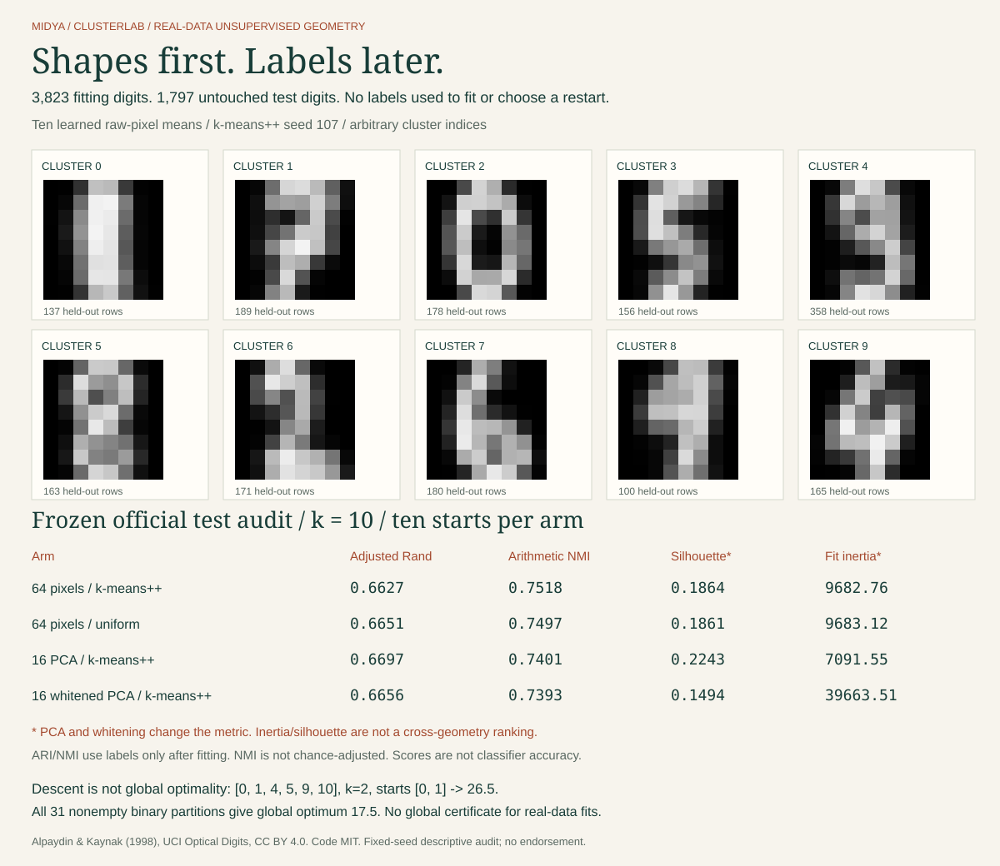

# ClusterLab

**Shapes first. Labels later.**

Forty real-data k-means fits, explicit optimization witnesses, and an editable browser inspector. Manual NumPy algorithms, original licensed UCI data, independent numerical references. No scikit-learn, model APIs or training labels.



## Run it

```bash
python -m pip install -e .
python -m clusterlab demo
python -m unittest discover -s tests -v
node --test tests/*.cjs   # Node 22+ and Chrome; CHROME_BIN overrides the executable
bash examples/demo.sh
```

Try the [live clustering inspector](https://midya8.github.io/clusterlab/), or open `docs/index.html` locally. It recomputes all ten distances for editable 8x8 digits, with keyboard controls, four fixed model arms, a centroid atlas, test-label composition, every restart's descent curve and copy/download JSON witnesses. No server, uploads, analytics or remote model calls. Twenty original test rows are included by index, not selected for success.

## What's built

- D² k-means++ and uniform distinct-value initializers, explicit lowest-index assignment ties, Lloyd mean updates, empty-center repairs and full monotone objective histories.
- Ten seeds per arm; the selected run minimizes **fitting inertia**, not a label score. All 40 starts, center arrays, fitting assignments and initial row indices remain in the model artifact.
- Four prespecified arms: normalized 64-pixel k-means++ and uniform, fitting-only 16-component PCA, and 16-component whitened PCA. No test-based choice of k, dimension, normalization, initializer or seed.
- Independent ARI pair-count/null-permutation reference, entropy-based NMI reference, scalar all-pair silhouette reference, eigenspectrum/whitening checks and an exhaustive exact-rational local-optimum counterexample.
- A full refit test forbids test-loader access and supplies unusable training labels. Frozen file hashes are checked before held-out data load. All-row test evaluation is reproduced independently of saved scores.
- Python/JavaScript inference parity on all 80 public model/example pairs. Real Chrome exercises edits, keyboard, all 640 displayed centroid pixels, copy denial/success, download and expanded 320/390/1280 layouts.

## Measured official holdout

Original UCI 3,823 training / 1,797 test rows stay separate. Training uses **only training features**; digit labels enter after fitting for the external audit. Each arm chooses its lowest fitting inertia from seeds 100-109. All 40 runs reached stable assignments within the 200-update budget.

| Arm | Adjusted Rand | Arithmetic NMI | Silhouette in its own metric |
|---|---:|---:|---:|
| 64 pixels / k-means++ | 0.662690 | 0.751821 | 0.186434 |
| 64 pixels / uniform | 0.665149 | 0.749688 | 0.186142 |
| 16 PCA / k-means++ | 0.669707 | 0.740137 | 0.224268 |
| 16 whitened PCA / k-means++ | 0.665596 | 0.739303 | 0.149408 |

Raw k-means++ has slightly smaller fitting inertia than raw uniform (9682.7571 versus 9683.1241), but **uniform has slightly higher held-out ARI**. That is a descriptive result for these fixed starts, not a general seeding conclusion. ARI and NMI do not select the same arm. NMI is not chance-adjusted.

**PCA and whitening change the metric.** Cross-arm inertia/silhouette values are not directly comparable as if distances were unchanged. Silhouette uses all held-out Euclidean point-to-point distances in each arm's representation, with singleton silhouettes zero, not squared or centroid distances.

Cluster IDs are not digit predictions. We do not remap clusters with test labels and call that classification accuracy. A distance or runner-up gap is not a calibrated probability. This is unsupervised vector quantization, not OCR, semantic discovery or a production digit recognizer.

## Reproduce all 40 fits and the holdout audit

```bash
OPENBLAS_NUM_THREADS=1 python -m clusterlab train --out /tmp/clusterlab-refit
OPENBLAS_NUM_THREADS=1 python -m clusterlab evaluate --out /tmp/clusterlab-refit
python -m clusterlab predict examples/predict.json
```

`train` writes the fixed protocol before loading training features and never loads test rows. `evaluate` first checks the frozen protocol/model hashes in the saved evaluation plan, then opens the original test file. Changing these artifacts invalidates the plan. The hash guard detects mutation, not deliberate test-driven tuning by a person. There is no validation search: all dimensions, k, starts and geometries are fixed in advance.

The installed wheel includes data, artifacts and all eight modules. Its package CI runs all four CLIs outside the checkout, including a complete refit/evaluation. Rooted source examples export `docs/data.js` and the deterministic SVG; those publishing helpers are not installed console commands.

## Descent is not global optimality

On the tiny one-dimensional fixture `[0, 1, 4, 5, 9, 10]`, k=2 and initial centers `[0, 1]`, Lloyd converges monotonically to inertia **26.5**. Exhausting all 31 nonempty binary partitions with exact fractions gives **17.5**. The tests check both. We do not have a global-optimality certificate for the real-data fits. More restarts do not turn these finite observations into one.

## Data, credit and limits

Alpaydin, E. & Kaynak, C. (1998), [Optical Recognition of Handwritten Digits](https://archive.ics.uci.edu/dataset/80/optical+recognition+of+handwritten+digits), UCI Machine Learning Repository, DOI 10.24432/C50P49. Original numeric files are unmodified, hashes checked at load, licensed CC BY 4.0. [Dataset license and changes](clusterlab/data/LICENSE.md). Normalization divides 8x8 block counts by 16; PCA and whitening are derived representations. UCI describes different writer groups in its original train/test split; individual writer IDs are not supplied. No exact feature duplicate crosses the split; near-duplicate/style dependence is not excluded.

This implements established algorithms, not a new clustering method. One dataset, fixed seeds, no confidence interval or general superiority claim. [METHOD.md](METHOD.md) gives equations, stopping and repair mechanics, geometry caveats, all six primary/documentation/data sources and the audit trail. No endorsement by cited authors or data providers. Original code MIT.
